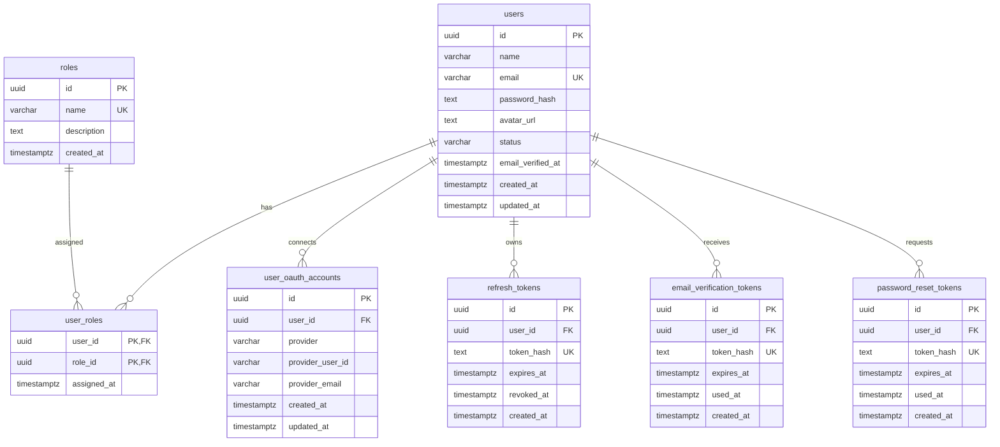
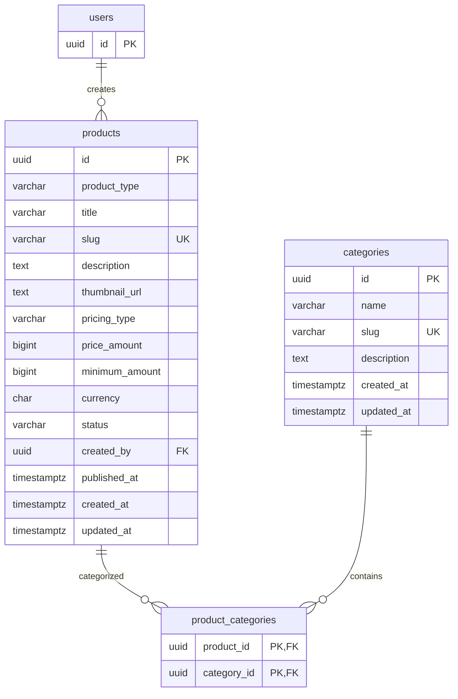
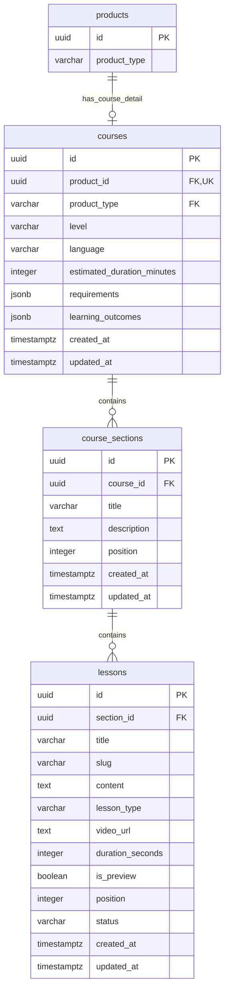
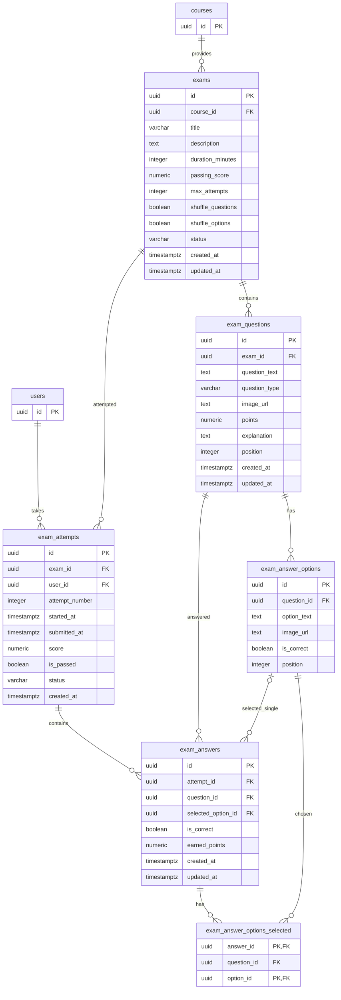
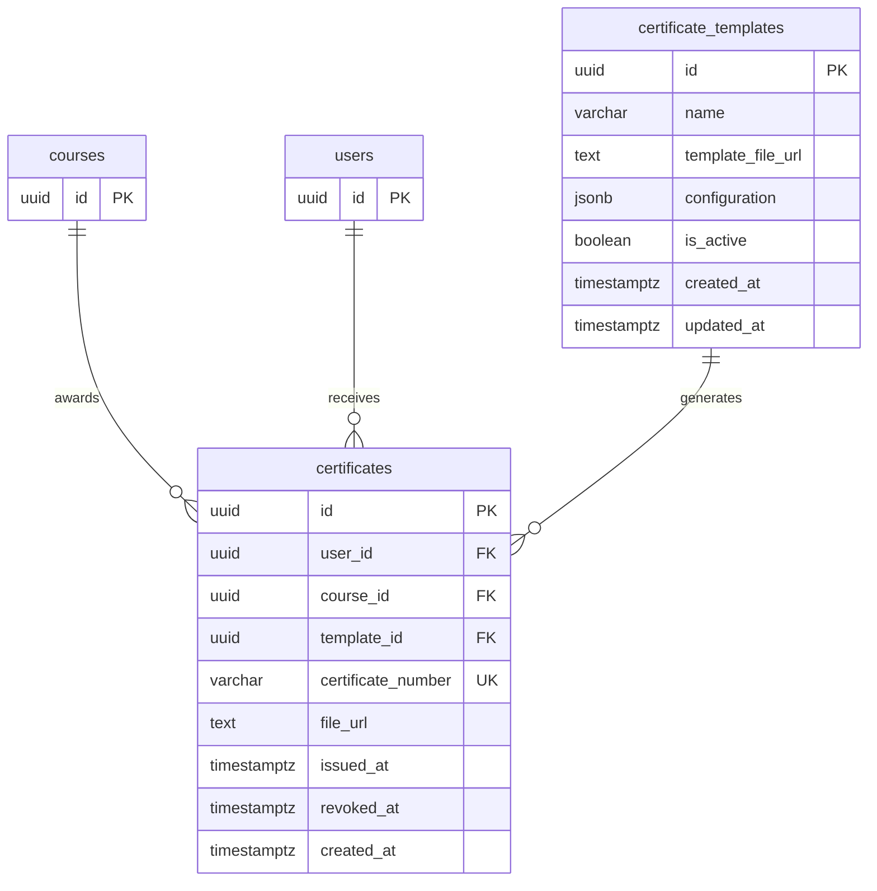
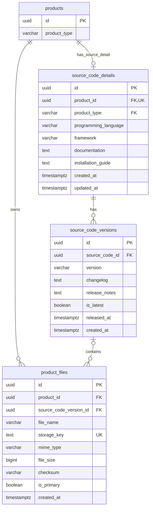
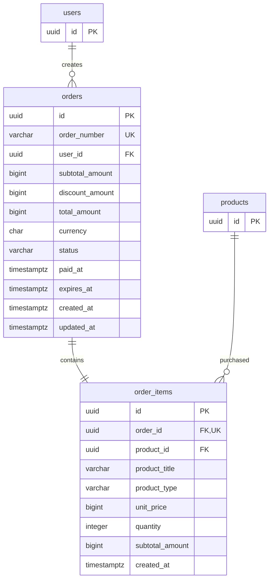
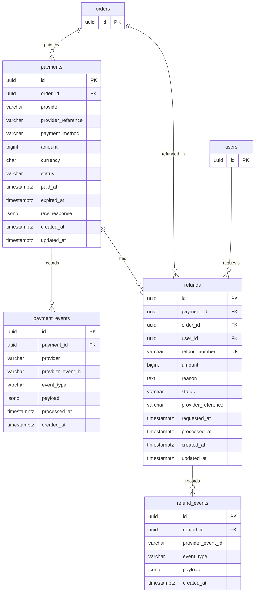
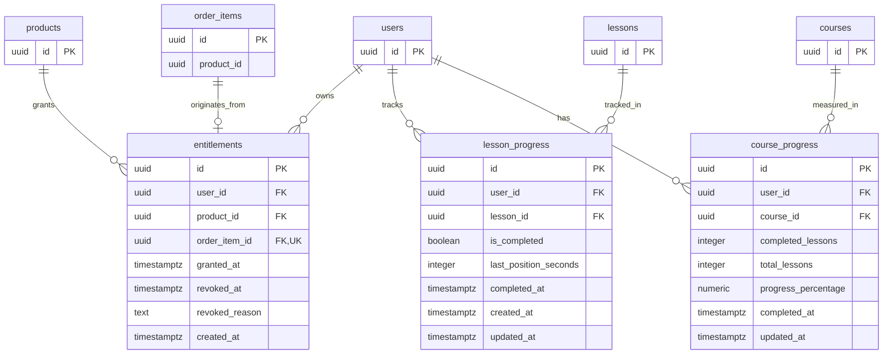
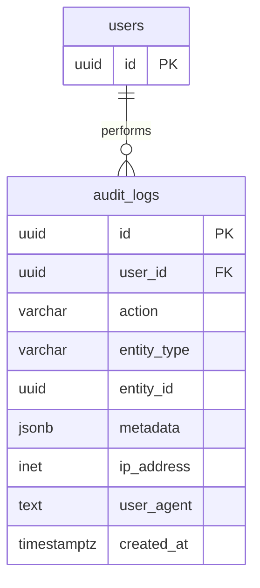

# Database Entity Relationship Diagram (ERD) — Nekadaja

**Versi:** 1.1  
**Status:** Revised Draft  
**Database:** PostgreSQL  
**Acuan:** `database-blueprint.md` (v1.2)

Dokumen ini menggambarkan struktur dan hubungan antar-entitas pada database platform Nekadaja. Diagram dibagi berdasarkan sepuluh domain pada blueprint agar lebih mudah dibaca, dikembangkan, dan dipelihara.

Keterangan notasi: `PK` primary key, `FK` foreign key, `UK` kolom unik. Kolom unik komposit, partial unique index, CHECK, dan aturan nullability dijelaskan di `database-dictionary.md`. Tabel dari domain lain yang hanya menjadi referensi ditampilkan dengan kolom `id` saja.

---

## 1. Identity & Access Management

Domain ini mengelola identitas pengguna, role, autentikasi, serta token yang dibutuhkan untuk proses keamanan akun.

Catatan: `user_oauth_accounts` memiliki unique komposit `(provider, provider_user_id)`.

---

## 2. Product Catalog

Domain ini mengelola produk yang tersedia di Nekadaja. Setiap produk memiliki kategori dan dapat berupa Course atau Source Code.

Catatan: `products` memiliki unique komposit `(id, product_type)` yang dipakai oleh foreign key komposit dari `courses` dan `source_code_details` (lihat domain 3 dan 6).

---

## 3. Course Management

Domain ini mengelola struktur pembelajaran: course, section, dan lesson.

Catatan:
- `courses (product_id, product_type)` adalah foreign key komposit ke `products (id, product_type)`. Kolom `product_type` pada `courses` selalu bernilai `course` (CHECK), sehingga course hanya dapat mengacu pada produk bertipe course.
- `course_sections` memiliki unique `(course_id, position)`; `lessons` memiliki unique `(section_id, slug)` dan `(section_id, position)`.

---

## 4. Examination Management

Domain ini mengelola ujian, pertanyaan, pilihan jawaban, percobaan ujian, dan jawaban peserta.

Catatan:
- `question_type` mendukung `single_choice`, `multiple_choice`, dan `true_false`.
- `exam_answers.selected_option_id` dipakai untuk `single_choice` dan `true_false`. Untuk `multiple_choice`, pilihan peserta disimpan di `exam_answer_options_selected`.
- Foreign key komposit `(question_id, selected_option_id)` dan `(question_id, option_id)` memastikan pilihan jawaban berasal dari pertanyaan yang dijawab.
- `exam_attempts` unik pada `(exam_id, user_id, attempt_number)`; `exam_answers` unik pada `(attempt_id, question_id)`.
- `score` dan `passing_score` sama-sama berskala persentase 0–100. `is_passed` disimpan sebagai snapshot saat penilaian.
- Penilaian dan penyimpanan jawaban harus konsisten agar hasil ujian tidak berubah ketika soal diperbarui. Pertanyaan dan pilihan yang sudah dijawab tidak dapat dihapus.

---

## 5. Certificate Management

Domain ini mengelola template sertifikat dan sertifikat yang diterbitkan kepada pengguna setelah memenuhi persyaratan course.

Catatan:
- Template sertifikat bersifat global dan tidak terikat pada satu course.
- Satu sertifikat aktif per `(user_id, course_id)`, dijaga partial unique index `WHERE revoked_at IS NULL`.

---

## 6. Source Code Management

Domain ini mengelola detail source code, versi produk, dan file yang dapat diunduh oleh pengguna.

Catatan:
- `source_code_details (product_id, product_type)` adalah foreign key komposit ke `products (id, product_type)`; `product_type` pada tabel ini selalu bernilai `source_code`.
- `source_code_versions.source_code_id` mengacu pada `source_code_details.id` dan unik bersama `version`. Hanya satu versi `is_latest` per source code.
- `product_files.source_code_version_id` bernilai NULL untuk file course dan terisi untuk file source code. Satu versi dapat memiliki beberapa file, dengan satu file primary.
- File disimpan di object storage atau file storage, bukan sebagai binary di PostgreSQL. Database hanya menyimpan metadata dan lokasi penyimpanannya.

---

## 7. Order Management

Domain ini mengelola transaksi pembelian. Satu order hanya berisi satu produk.

Catatan:
- `order_items.order_id` unik sehingga satu order hanya memiliki satu item, dan `quantity` selalu 1.
- `product_title`, `product_type`, dan `unit_price` adalah snapshot saat transaksi.
- Order gratis bernilai `total_amount = 0`, berstatus `paid`, dan tidak memiliki `payments`.

---

## 8. Payment & Refund Management

Domain ini mengelola pembayaran dan proses pengembalian dana.

Catatan:
- Satu order dapat memiliki beberapa percobaan pembayaran, tetapi hanya satu payment berhasil (partial unique index pada `order_id`).
- `payment_events` unik pada `(provider, provider_event_id)` dan `refund_events` unik pada `(refund_id, provider_event_id)` untuk menjamin webhook idempotent.
- `refunds` memakai foreign key komposit `(payment_id, order_id)` ke `payments` dan `(order_id, user_id)` ke `orders` agar `order_id` dan `user_id` selalu konsisten dengan payment.
- Refund yang masih dalam proses tidak otomatis mencabut hak akses pengguna.

---

## 9. Entitlement & Learning Progress

Domain ini menentukan hak akses pengguna terhadap produk yang telah diperoleh (pembelian atau klaim gratis) serta mencatat progres belajar.

Catatan:
- Hak akses produk bersifat permanen dan tidak memiliki tanggal kedaluwarsa. Entitlement aktif adalah entitlement dengan `revoked_at IS NULL`.
- Satu entitlement aktif per `(user_id, product_id)` dijaga partial unique index.
- Foreign key komposit `(order_item_id, product_id)` ke `order_items (id, product_id)` memastikan produk entitlement sama dengan produk yang dipesan.
- Jika terjadi refund yang disetujui dan berhasil, entitlement dapat dicabut sesuai kebijakan refund.
- `lesson_progress` unik pada `(user_id, lesson_id)`; `course_progress` unik pada `(user_id, course_id)`.

---

## 10. System & Audit

Domain ini mencatat aktivitas penting untuk kebutuhan keamanan, pelacakan, dan audit sistem.

`user_id` dapat bernilai `NULL` untuk aktivitas sistem atau aktivitas yang tidak memiliki pengguna terautentikasi. Nilai sebelum dan sesudah perubahan disimpan di `metadata`.

---

## 11. Ringkasan Relasi Utama

| Domain | Relasi utama |
|---|---|
| Identity | Users ↔ Roles |
| Catalog | Products ↔ Categories |
| Course | Courses → Sections → Lessons |
| Examination | Exams → Questions → Answer Options |
| Certificate | Users → Certificates |
| Source Code | Source Code → Versions → Files |
| Commerce | Users → Orders → Order Items |
| Payment | Orders → Payments → Events |
| Refund | Payments → Refunds → Events |
| Access | Users → Entitlements → Products |
| Learning | Users → Lesson Progress / Course Progress |
| Audit | Users → Audit Logs |

---

## 12. Catatan Implementasi

Dokumen ERD ini merupakan representasi konseptual dan logis berdasarkan Database Blueprint v1.2. Poin-poin berikut sudah diputuskan di blueprint dan perlu dipertahankan saat membuat migration SQL:

1. Konsistensi `product_type` dengan tabel detail dijaga foreign key komposit `(product_id, product_type)`.
2. Pertanyaan ujian `multiple_choice` didukung melalui tabel `exam_answer_options_selected`.
3. File produk mendukung banyak file per versi (satu primary); `product_files.product_id` dan versi harus sejalan, divalidasi aplikasi atau trigger.
4. Sertifikat aktif ganda dicegah partial unique index pada `(user_id, course_id)`.
5. Pembayaran berulang dibatasi satu payment berhasil per order; idempotensi webhook dijaga unique event ID.
6. Aturan pencabutan entitlement setelah refund berhasil masih menunggu keputusan kebijakan refund.
7. Entitlement aktif ganda dan progres belajar duplikat dicegah constraint unik.

**Prinsip:** ERD menjadi acuan hubungan data, sedangkan aturan bisnis dan constraint database dijelaskan di blueprint dan data dictionary, lalu diterapkan pada tahap implementasi schema dan migration.
